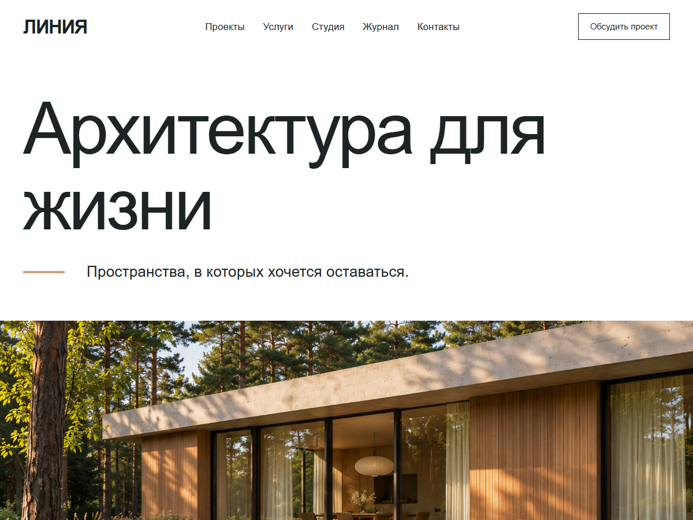

# Линия — собственная тема WordPress

Проекты архитектурного бюро, услуги, журнал и демонстрационная форма обращения.

[Работающее демо](https://linea.komaroff-dev.ru/) · [Полный сайт с окружением](https://github.com/komaroffsergei/linea-wordpress-site)

Классическая тема на PHP, CSS и JavaScript. Контент берётся из WordPress, адаптивная сетка работает на телефоне, планшете и компьютере. Без визуального конструктора.

## Установка

1. Установите WordPress с PHP 8.1 или новее.
2. Скопируйте этот репозиторий в `wp-content/themes/komaroff-linea` и активируйте тему.
3. Установите [Komaroff Demo Content](https://github.com/komaroffsergei/wordpress-demo-content) для типов контента, форм и настроек главной.
4. Создайте материалы, страницы и основное меню в панели WordPress.
5. Для воспроизведения готового демо используйте отдельный репозиторий сайта по ссылке выше: он закрепляет версии темы и плагина.

## Авторство и границы

Авторский демонстрационный проект Сергея Комарова. Компании, персонажи, товары и объекты вымышлены. Изображения сгенерированы для этого проекта. Дизайн подготовлен самостоятельно с опорой на направление премиальных макетов; чужие исходники и изображения из платных шаблонов не включены.

Формы сохраняют тестовые сообщения; письма не отправляются. Реальных платежей и доставки нет. Проверки опубликованной версии выполнены 5 ноября 2026 года.

## Лицензия

GPL-2.0-or-later, см. [LICENSE.txt](LICENSE.txt).
